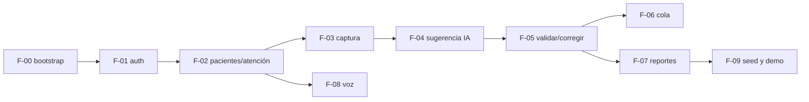

# Roadmap global

Mapa de las features globales `F-0X` a sus slices por repo. El **estado vivo** de cada slice está en el `feature_list.json` de su repo; esta tabla es el plan y se actualiza cuando un slice llega a `done`.

## Backlog

| Global | Feature | api | web | mobile | SDD | Brief |
|---|---|---|---|---|---|---|
| F-00 | Bootstrap técnico del repo | F-00-api | F-00-web | F-00-mobile | no | — |
| F-01 | Autenticación, roles y tenancy | F-01-api | F-01-web | F-01-mobile | sí | [F-01](product/features/F-01.md) |
| F-02 | Pacientes y atención (llegada con hora del servidor) | F-02-api | F-02-web (consulta) | F-02-mobile | sí | [F-02](product/features/F-02.md) |
| F-03 | Captura clínica | F-03-api | F-03-web | — | sí | [F-03](product/features/F-03.md) |
| F-04 | Sugerencia por LLM + SafetyGuards + fallback manual | F-04-api | F-04-web | — | sí | [F-04](product/features/F-04.md) |
| F-05 | Validar o corregir la sugerencia | F-05-api | F-05-web | — | sí | [F-05](product/features/F-05.md) |
| F-06 | Cola priorizada por nivel y espera | F-06-api | F-06-web | — | sí | [F-06](product/features/F-06.md) |
| F-07 | Reportes de tiempos, cumplimiento, concordancia y CSV | F-07-api | F-07-web | — | sí | [F-07](product/features/F-07.md) |
| F-08 | Dictado del motivo en el dispositivo | — | — | F-08-mobile | sí | [F-08](product/features/F-08.md) |
| F-09 | Datos sintéticos y guion de demo | F-09-api | — | — | no | [F-09](product/features/F-09.md) |

## Orden y dependencias

Regla entre repos: **primero el contrato**. `F-0X-web` y `F-0X-mobile` no pasan a `in_progress` hasta que `F-0X-api` esté `done` y su versión de contrato esté publicada en `openapi/asclepio-api.v1.json`.

## Estado de slices

| Slice | Estado | Versión de contrato |
|---|---|---|
| F-00-api | done (2026-10-26) | 0.1.0 |
| F-00-web / F-00-mobile | pending | — |
| Todos los demás | pending | — |

## Trazabilidad F-0X.ACn → R<n>

Cada spec (`specs/<id>/requirements.md`) traza sus `R<n>` a los criterios globales. Cuando una spec se aprueba, su fila se añade aquí:

| Criterio global | Slice | Requisitos | Prueba(s) |
|---|---|---|---|
| — | — | — | — |

## Preguntas abiertas (consolidado)

No se implementa nada que dependa de estas preguntas hasta que se respondan. El detalle de cada una está en su brief.

| ID | Tema | Bloquea |
|---|---|---|
| PA-F01-1..4 | Duración del token, política de contraseñas, multi-rol, roles en el móvil | F-01 |
| PA-F02-1..4 | Datos mínimos del paciente, transiciones de estado y quién las hace | F-02 |
| PA-F03-1..4 | Lista de signos vitales, **rangos fisiológicos**, catálogo de síntomas | F-03 |
| PA-F04-1 | **Reglas y umbrales de los SafetyGuards** (asesor clínico) | F-04 |
| PA-F04-2..7 | Modelo y versión, timeout, disparo de la sugerencia, re-sugerencia, viñetas, saneamiento del texto | F-04 |
| PA-F05-1..3 | Re-triage, catálogo de motivos, VALIDATE con guard | F-05 |
| PA-F06-1..5 | **Tiempos máximos de I, III, IV y V**, definición de espera, refresco, alcance por sede | F-06 |
| PA-F07-1..4 | **Formato oficial Res. 373 / SISPRO**, tipo de kappa, métricas, documento en el CSV | F-07 |
| PA-F08-1..2 | Texto editado tras el dictado, dispositivos objetivo | F-08 |
| PA-F09-1 | Volumen de los datos de demo | F-09 |
| PA-ADR3 | Quién ejecuta `migrate deploy` sobre la base compartida | Primera migración |
