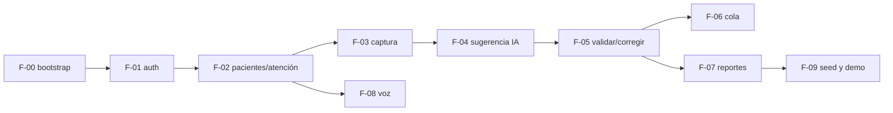

# Roadmap global

Mapa de las features globales `F-0X` a sus slices por repo. El **estado vivo** de cada slice está en el `feature_list.json` de su repo; esta tabla es el plan y se actualiza cuando un slice llega a `done`.

## Backlog

| Global | Feature | api | web | mobile | SDD | Brief |
|---|---|---|---|---|---|---|
| F-00 | Bootstrap técnico del repo | F-00-api | F-00-web | F-00-mobile | no | — |
| F-01 | Autenticación, roles y tenancy | F-01-api | F-01-web | F-01-mobile | sí | [F-01](product/features/F-01.md) |
| F-02 | Pre-registro del paciente y confirmación de llegada (hora del servidor) | F-02-api | F-02-web (confirmación + consulta) | F-02-mobile (pre-registro) | sí | [F-02](product/features/F-02.md) |
| F-03 | Captura clínica | F-03-api | F-03-web | — | sí | [F-03](product/features/F-03.md) |
| F-04 | Sugerencia por LLM + SafetyGuards + fallback manual | F-04-api | F-04-web | — | sí | [F-04](product/features/F-04.md) |
| F-05 | Validar o corregir la sugerencia | F-05-api | F-05-web | — | sí | [F-05](product/features/F-05.md) |
| F-06 | Cola priorizada por nivel y espera | F-06-api | F-06-web | — | sí | [F-06](product/features/F-06.md) |
| F-07 | Reportes de tiempos, cumplimiento, concordancia y CSV | F-07-api | F-07-web | — | sí | [F-07](product/features/F-07.md) |
| F-08 | Dictado del motivo en el dispositivo | — | — | F-08-mobile | sí | [F-08](product/features/F-08.md) |
| F-09 | Datos sintéticos y guion de demo | F-09-api | — | — | no | [F-09](product/features/F-09.md) |

## Orden y dependencias

Regla entre repos: **primero el contrato**. `F-0X-web` y `F-0X-mobile` no pasan a `in_progress` hasta que `F-0X-api` esté `done` y su versión de contrato esté publicada en `openapi/asclepio-api.v1.json`.

## Estado de slices

| Slice | Estado | Versión de contrato |
|---|---|---|
| F-00-api | done (2026-10-26) | 0.1.0 |
| F-00-web | done (2026-10-26) | consume 0.1.0 |
| F-00-mobile | done (2026-10-26) | consume 0.1.0 |
| F-01-api | done (2026-10-26) | 0.2.1 (0.2.0 + corrección de tipo de `consentVersion`) |
| F-01-web | done (2026-10-26) | consume 0.2.1 |
| F-02-api | done (2026-10-27) | 0.3.0 |
| F-01-mobile | done (2026-10-27) | consume 0.2.1 |
| F-03-api | done (2026-10-27) | 0.4.0 |
| F-04-api | done (2026-11-09) | 0.5.0 |
| F-05-api | done (2026-11-09) | 0.6.0 |
| F-06-api | done (2026-11-09) | 0.7.0 |
| Todos los demás | pending | — |

## Trazabilidad F-0X.ACn → R<n>

Cada spec (`specs/<id>/requirements.md`) traza sus `R<n>` a los criterios globales. Cuando una spec se aprueba, su fila se añade aquí:

| Criterio global | Slice | Requisitos | Prueba(s) |
|---|---|---|---|
| F-01.AC1 | F-01-api | R1, R2, R4–R7, R19, R36 | `R<n>:` en `src/modules/auth/*.spec.ts`, `test/*.e2e-spec.ts` y `test/int/*.int-spec.ts` |
| F-01.AC2 | F-01-api | R1, R11, R14, R17, R40–R43, R48–R51 | ídem |
| F-01.AC3 | F-01-api | R8–R11, R36 | ídem |
| F-01.AC4 | F-01-api | R15, R16 | ídem |
| F-01.AC5 | F-01-api | R27–R35 | ídem |
| F-01.AC7 | F-01-api | R3–R7, R12, R13, R18–R20, R23–R25, R37, R39, R44–R47 | ídem |
| F-01.AC8 | F-01-api | R20–R22, R26, R31, R38 | ídem |
| F-03.AC1 | F-03-api | R1–R3, R11–R13, R19–R21 | `R<n>:` en `src/modules/encounters/*.spec.ts`, `test/*.e2e-spec.ts` y `test/int/*.int-spec.ts` |
| F-03.AC2 | F-03-api | R3–R6, R22 | ídem |
| F-03.AC3 | F-03-api | R7–R12, R19–R21 | ídem |
| F-03.AC4 | F-03-api | R14–R18 | ídem |
| F-04.AC1 | F-04-api | R1–R5, R7, R16, R22, R28 | `R<n>:` en `src/modules/ai/*.spec.ts`, `test/f04-*` y `test/int/*.int-spec.ts` |
| F-04.AC2 | F-04-api | R8–R10, R27 | ídem |
| F-04.AC3 | F-04-api | R15, R16, R22 | ídem |
| F-04.AC4 | F-04-api | R1, R11–R14, R22, R29 | ídem |
| F-04.AC5 | F-04-api | R17–R19 | ídem |
| F-04.AC6 | F-04-api | R6, R20, R21, R24–R26 | ídem |
| F-04.AC7 | F-04-api | R23, R24 | ídem |
| F-04.AC9 | F-04-api | R30–R32 | ídem |
| F-05.AC1 | F-05-api | R1–R8, R14–R16, R23 | `R<n>:` en `src/modules/triage/**/*.spec.ts`, `test/f05-*` |
| F-05.AC2 | F-05-api | R1–R4, R15, R16, R19, R20 | ídem |
| F-05.AC3 | F-05-api | R9–R11, R13, R17, R18 | ídem |
| F-05.AC4 | F-05-api | R22 | ídem |
| F-05.AC5 | F-05-api | R12, R19 | ídem |
| F-05.AC6 | F-05-api | R9, R10, R17, R21 | ídem |
| F-06.AC1 | F-06-api | R1–R3, R5, R6, R8–R14 | `R<n>:` en `src/modules/queue/*.spec.ts`, `test/f06-*` |
| F-06.AC2 | F-06-api | R1 | ídem |
| F-06.AC3 | F-06-api | R2, R4 | ídem |
| F-06.AC5 | F-06-api | R2, R7, R15 | ídem |

## Alcance del móvil (ratificado 2026-11-09)
La app móvil es **solo del paciente** (ADR 0008, ratificado por el humano el 2026-11-09). Las funciones de personal añadidas en `asclepio-mobile` el 2026-10-29 (ADR local 0002) se retiran en un slice de limpieza del móvil. F-03 a F-07 no tienen slice móvil.

## Preguntas abiertas (consolidado)

No se implementa nada que dependa de estas preguntas hasta que se respondan. El detalle de cada una está en su brief.

| ID | Tema | Bloquea |
|---|---|---|
| ~~PA-F01-1..3~~ | Resueltas el 2026-10-26 (JWT de 8 h sin refresh; contraseña ≥ 10 y bloqueo de 15 min tras 5 intentos; un rol y un tenant por usuario) | — |
| ~~PA-F01-4~~ | Resuelta en el ADR 0008: el móvil lo usa el **paciente** en su teléfono, con cuenta propia; recepción confirma en la web; la llegada legal es la confirmación | — |
| ~~PA-PAC-1..6~~ | Resueltas el 2026-10-26 (ADR 0008): documento + contraseña; sede de una lista; expira a las 6 h; el paciente solo ve el estado (no el nivel); casilla de consentimiento Ley 1581 con `consent_at` y versión; sin cuentas de menores | — |
| ~~PA-F02-1..9~~ | Resueltas el 2026-10-26 (propuestas de la spec de F-02-api aceptadas: datos mínimos y NN, paso automático a WAITING_TRIAGE, cancelación por RECEPTION/NURSE con motivo, IN_CARE/CLOSED por PHYSICIAN en F-06, edición limitada del perfil, un pendiente y una atención activa, rechazo por recepción, filtro por sede, estado sin nivel) | — |
| ~~PA-F03-1..4~~ | Resueltas el 2026-10-27 (spec de F-03-api): signos del NEWS2 y rangos amplios de plausibilidad, **PROVISIONALES, no validados clínicamente — revisar con asesor clínico**; hallazgos en texto libre estructurado; el motivo no se edita (notas `COMPLAINT_NOTE`) | — |
| ~~PA-F04-1..7~~ | Resueltas el 2026-11-09 (spec de F-04-api): SafetyGuards sobre NEWS2 RCP 2017 con G1 (≥ 7 → máx. II), G2 (5–6 → máx. III) y G3 (parámetro = 3 → máx. III), **PROVISIONALES, no validados clínicamente — revisar con asesor clínico**; `openai/gpt-oss-120b` en Groq y OpenRouter; 8 s por llamada, 1 reintento (OpenRouter) y 20 s en total; botón explícito; re-sugerencia en `WAITING_TRIAGE` (se muestra la más reciente); 20 viñetas en borrador sin subclasificar I–II; saneamiento de nombre y documento | — |
| ~~PA-F05-1..3~~ | Resueltas el 2026-11-09 (spec de F-05-api): sin re-triage (409); motivo de corrección en texto libre de 1 a 500 caracteres; `VALIDATE` usa el nivel ya ajustado por el guard | — |
| ~~PA-F06-1..5~~ | Resueltas el 2026-11-09 (spec de F-06-api): solo I (0 min) y II (30 min) de la Res. 5596, III–V sin alerta; espera desde la llegada hasta `IN_CARE`; refresco de 30 s; cola por sede con filtro; iniciales, edad y sexo | — |
| ~~PA-F07-1..4~~ | Resueltas el 2026-11-10 (spec de F-07-api): CSV interno (no oficial), kappa ponderado cuadrático, n/mediana/p90, sin documento; cumplimiento del Triage II según la Res. 256 de 2016 (desde la clasificación) | — |
| PA-F08-1..2 | Texto editado tras el dictado, dispositivos objetivo | F-08 |
| PA-F09-1 | Volumen de los datos de demo | F-09 |
| ~~PA-ADR3~~ | Resuelta el 2026-10-26: solo el responsable de backend ejecuta `migrate deploy` en la base compartida y avisa al equipo | — |
| ~~PA-TEST~~ | Resuelta el 2026-10-26: las pruebas de integración usan PostgreSQL local (Docker); Supabase solo para desarrollo y demo | — |
